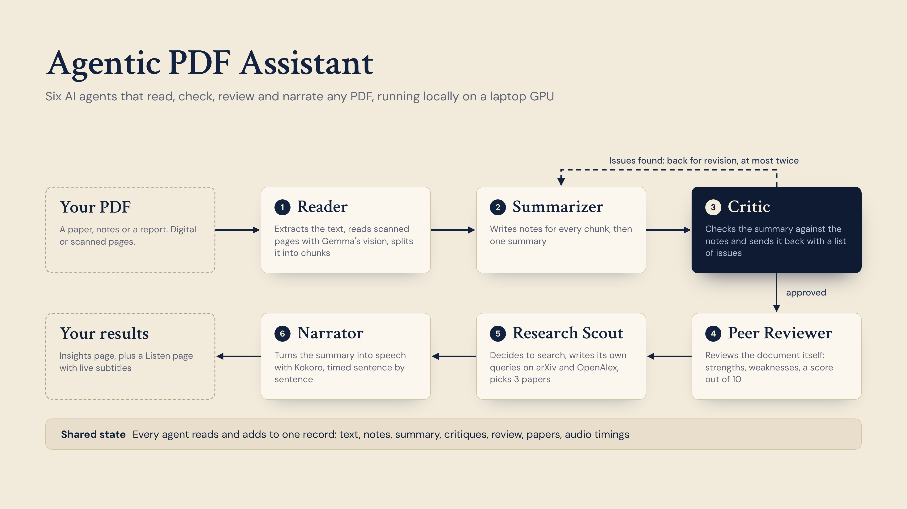

<h1 align="center">Agentic PDF Assistant</h1>

<p align="center">
  A team of AI agents that reads any PDF, writes a fact-checked summary, reviews the work like a
  peer reviewer, finds related papers, and reads the summary aloud with live subtitles.<br>
  Runs locally on a laptop GPU with Google's open Gemma 4 model.
</p>

<p align="center">
  
</p>

---

## What it does

Drop in a PDF (a research paper, lecture notes, a report) and a pipeline of agents works on it, each with one job:

- **Summary** that a Critic agent checks against the source and sends back for revision when something is wrong or missing
- **Peer review** of the document itself: strengths, weaknesses, questions for the authors and a score out of 10
- **Related papers** found by an agent that decides on its own whether a search is worth doing, writes its own queries and picks the best 3
- **Audio summary** with word-by-word subtitles synced to the voice, and a clickable transcript
- **File Finder** that locates PDFs on your laptop from a plain description, like *"my control systems notes from last month"*

Everything except the paper search runs on your own machine. Documents never leave the laptop.

<p align="center">
  
</p>

## The agents

| Agent | Job | How it works |
| --- | --- | --- |
| **Reader** | Gets clean text out of the PDF | PyMuPDF extracts text from digital pages. Pages with almost no text are treated as scanned: they're rendered to an image and read by Gemma 4's vision, so no Tesseract is needed. Text is split into chunks. |
| **Summarizer** | Writes the summary | Map-reduce: bullet notes for each chunk, merged if too long, then one summary (overview, key points, conclusion). Rewrites it when the Critic finds issues. |
| **Critic** | Fact-checks the summary | Compares the summary with the notes and returns JSON: approved, or a list of unsupported claims, missing points and wrong numbers. Sends it back at most twice. |
| **Peer Reviewer** | Reviews the document itself | Conference-style review: strengths, weaknesses, questions, score. |
| **Research Scout** | Finds 3 related papers | Decides whether searching helps, writes its own queries, searches arXiv and OpenAlex (by relevance and by citations), ranks the results and searches again if they're poor. Returns links only; nothing is downloaded. |
| **Narrator** | Reads the summary aloud | Rewrites the summary as a spoken script (equations in words), then records it sentence by sentence with Kokoro, saving each sentence's timing for the subtitles. |
| **File Finder** | Finds PDFs on your laptop | Turns a plain request into keywords, dates and a folder, searches a local full-text index of file names and PDF text, retries with synonyms when nothing matches, and ranks the best files. One click sends a file into the pipeline. |

### How the pipeline runs

```
PDF -> Reader -> Summarizer <-> Critic -> Peer Reviewer -> Research Scout -> Narrator -> results
                     (up to 2 revisions)
```

The agents are wired together with **LangGraph** and share one state object (text, notes, summary,
critiques, review, papers, audio timings). The Critic is the only place the flow goes backwards.
The Research Scout and the File Finder each run their own bounded loop inside their step:
reason, act (search), observe the results, and try again if needed.

## Tech stack

| Layer | Used | Why |
| --- | --- | --- |
| Language model | **Gemma 4 E4B** via **Ollama** | Strong for its size, reads images, and the 4-bit version fits in 8 GB of VRAM |
| Orchestration | **LangGraph** | Shared state, the conditional Critic loop, agent order as a graph |
| PDF | **PyMuPDF** | Fast, exact text extraction; renders scanned pages for OCR |
| Paper search | **arXiv API**, **OpenAlex** | Free, no API keys, legal open-access links |
| Local file search | **SQLite FTS5** | Built-in full-text search over PDF names and text, updated incrementally |
| Speech | **Kokoro-82M** (kokoro-onnx), gTTS as fallback | Natural voice, fully offline, runs on the CPU so the GPU stays free for Gemma |
| Backend | **FastAPI** | Uploads, background jobs, live progress, search and audio endpoints |
| Frontend | **React** + **Vite**, **KaTeX** | Live agent timeline, results pages, formulas rendered properly, custom audio player |

### Built for an 8 GB GPU

- **One model, many roles.** Every agent is the same Gemma model with a different prompt, so only one model is ever in VRAM.
- **Map-reduce summarizing.** The context window is kept at 8K tokens to save VRAM, so long PDFs are summarized chunk by chunk.
- **One job at a time.** A GPU lock queues jobs and searches so they never compete for memory.
- **Structured, validated output.** Agents that make decisions answer in JSON, and the code checks every answer before acting on it.
- **Bounded autonomy.** Every loop has a hard limit, so no agent can run forever.
- **Fail soft.** If Kokoro fails, gTTS takes over; if a search source is down, the others still answer.

## Getting started

Tested on Windows 11 with an RTX 4060 laptop GPU (8 GB) and 16 GB of RAM.

### 1. Requirements

- [Ollama](https://ollama.com/download) 0.20 or newer
- Python 3.10+ (conda or venv)
- Node.js 18+

### 2. Download the model

```powershell
ollama pull gemma4:e4b
```

### 3. Backend

```powershell
cd backend
conda create -n pdfagent python=3.10 -y
conda activate pdfagent
pip install -r requirements.txt
```

**Voice model (one time):** download `kokoro-v1.0.onnx` and `voices-v1.0.bin` from the
[kokoro-onnx releases](https://github.com/thewh1teagle/kokoro-onnx/releases) (`model-files-v1.0`)
into `backend/models/kokoro/`, or anywhere you like and point `KOKORO_DIR` in
`backend/config.py` at that folder. Without them, audio falls back to gTTS.

### 4. Frontend

```powershell
cd frontend
npm install
```

### 5. Run

Two terminals, with Ollama running in the background:

```powershell
# terminal 1
cd backend
uvicorn main:app --port 8000

# terminal 2
cd frontend
npm run dev
```

Open **http://localhost:5173**.

### Command-line tools

```powershell
python run_cli.py paper.pdf                          # full pipeline in the terminal
python run_search.py "original transformer paper"    # Research Scout only
python run_find.py "control systems notes"           # File Finder only
```

## Configuration

Everything lives in `backend/config.py`:

| Setting | Default | What it does |
| --- | --- | --- |
| `MODEL` | `gemma4:e4b` | Use `gemma4:e2b` if you run out of memory |
| `NUM_CTX` | `8192` | Context window; larger needs more VRAM |
| `MAX_REVISIONS` | `2` | Summarizer and Critic rounds |
| `SCOUT_AUTO` | `True` | Let the Research Scout decide by itself whether to search |
| `SCOUT_MAX_PAPERS` | `3` | Papers returned |
| `KOKORO_DIR` | `backend/models/kokoro` | Where the voice model files are |
| `KOKORO_VOICE` | `af_heart` | Try `am_michael`, `bf_emma` or `bm_george` |
| `FINDER_ROOTS` | Downloads, Documents, Desktop | The only folders the File Finder may read |

### File Finder and privacy

The File Finder only scans the folders in `FINDER_ROOTS`. It never modifies, moves or deletes your
files, and analysis works on a copy. Requests for any path outside those folders are refused by
the backend. The index (`backend/finder_index.sqlite`) is rebuilt in the background when the server
starts and only re-reads new or changed PDFs. Scanned PDFs without a text layer are found by file
name only.

## Project structure

```
backend/
  agents/        reader, summarizer, critic, reviewer, scout, narrator, finder
  tools/         search.py (arXiv, OpenAlex)  files.py (local PDF index)
  graph.py       LangGraph pipeline
  state.py       shared state passed between agents
  llm.py         Ollama wrapper
  main.py        FastAPI server
  config.py      all settings
frontend/
  src/components Upload, FileFinder, Pipeline, Insights, Listen, Papers, Markdown
  src/timing.js  subtitle timing
```

## Limitations

- The Critic checks that the summary matches the document, not that the document is correct. A
  test PDF with 9 planted errors showed this: the summary repeated them and only the Peer Reviewer
  flagged them.
- A 4B model judges less reliably than large cloud models, for example when ranking papers.
- Word timing inside a sentence is estimated from word length; sentence timing is exact.

## Roadmap

- [ ] Fact-Checker agent, and writing the summary after the review so errors get corrected
- [ ] Run code snippets from the PDF in a sandbox to catch syntax and logic errors
- [ ] Page citations in the summary that open the PDF at the right page
- [ ] Q&A agent: chat with the PDF
- [ ] Planner agent that runs only the agents a request needs
- [ ] Save past results across server restarts

## Author

**Deepak Skandh**
